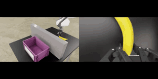
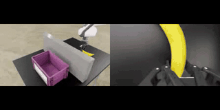

# OpenPI Backend

This repository serves OpenPI policies and includes an IsaacLab DROID simulation client for evaluating DROID-style policies. It is a derivative work based on [Physical Intelligence OpenPI](https://github.com/Physical-Intelligence/openpi) and [sim-evals Isaac envs](https://github.com/arhanjain/sim-evals). It extends the original codebase with OmniGuide collision and semantic guidance, VLM monitoring, and release-ready IsaacLab DROID evaluation scripts.

> **License Notice:** This project is derived from OpenPI and is distributed under the [Apache License 2.0](LICENSE). Third-party submodules and dependencies retain their original licenses. See [License](#license) for details.

The default release workflow is:

1. Install the root OpenPI backend with `uv`.
2. Install the VLM monitor service used by guided pi0 policies.
3. Start the monitor, policy server, and IsaacLab DROID client from `third_party/IssacLab_Droid`.

## Requirements

- Ubuntu Linux with an NVIDIA GPU.
- A recent NVIDIA driver with working CUDA and Vulkan.
- `git`, `git-lfs`, `uv`, Docker, Docker Compose, and `nvidia-container-toolkit`.
- Enough GPU memory for the policy checkpoint you serve. For DROID inference, a 24 GB GPU class machine is a practical baseline.

Isaac Sim is installed through the IsaacLab client environment. On first use, NVIDIA Omniverse may require EULA acceptance.

## Install

Clone with submodules:

```bash
git clone --recurse-submodules git@github.com:OmniGuide-Code/omniguide-openpi.git
cd OmniGuide-Code
```

If the repository was already cloned:

```bash
git submodule update --init --recursive
```

Install the root backend:

```bash
GIT_LFS_SKIP_SMUDGE=1 uv sync
```

Validate that the OpenCV wheel installed correctly:

```bash
uv run python - <<'PY'
import cv2

assert hasattr(cv2, "setNumThreads"), "Broken OpenCV install: recreate .venv and run uv sync again."
print(cv2.__version__)
PY
```

Set up the required PyTorch policy checkpoint before running guided evaluation. Guidance is implemented in `pi0_pytorch.py`; the JAX policy path is not supported for collision or semantic guidance. If `torchckpts/pi05droid/model.safetensors` is not already present, follow [docs/torch_policy_setup.md](docs/torch_policy_setup.md).

Install the VLM monitor service:

```bash
cd third_party/monitor_guided_pi
uv sync --python 3.11
cd ../..
```

Configure Docker GPU support once:

```bash
sudo apt-get install -y nvidia-container-toolkit
sudo nvidia-ctk runtime configure --runtime=docker
sudo systemctl restart docker
```

Validate Docker can see the GPU:

```bash
docker run --rm --gpus all nvidia/cuda:12.8.1-base-ubuntu22.04 nvidia-smi
```

Set up the IsaacLab DROID client container:

```bash
cd third_party/IssacLab_Droid
./dev/up.sh
cd ../..
```

Do not manually activate `.venv` for normal use. Prefer `uv run ...` from the directory that owns the command.
The simulation client is intended to run in Docker; this avoids host X11/Vulkan setup differences.
Use `./dev/down.sh` from `third_party/IssacLab_Droid` to stop the client container.

## Run DROID Sim Eval

Open three terminals.

Terminal 1: start the VLM monitor.

Create `openpi_backend/third_party/monitor_guided_pi/.env` and set:

```bash
GOOGLE_API_KEY=<your-google-api-key>
```

Then start the monitor:

```bash
cd third_party/monitor_guided_pi
uv run python server.py
```

The monitor listens on `localhost:8766` by default. `VLM_API_KEY` is also accepted in `.env` and takes precedence over `GOOGLE_API_KEY`.

Terminal 2: start the policy server from the repository root.

For the collision scene with OmniGuide:

```bash
XLA_PYTHON_CLIENT_MEM_FRACTION=0.5 uv run server.py real_robot=false guidance=collision_sim
```

For the semantic scene with OmniGuide:

```bash
XLA_PYTHON_CLIENT_MEM_FRACTION=0.5 uv run server.py real_robot=false guidance=vlm_pointer_collision_sim
```

For a no-guidance baseline comparison, run the base pi05 policy with OmniGuide disabled:

```bash
XLA_PYTHON_CLIENT_MEM_FRACTION=0.5 uv run server.py real_robot=false guidance=base
```

The VLM monitor is not needed for `guidance=base`.

The server listens on `localhost:8765` by default.
Release defaults are debug-friendly: Viser is enabled, intermediate images are saved, and the server pauses before returning each action chunk so you can inspect `http://localhost:8080`.

Terminal 3: start the IsaacLab client.

```bash
cd third_party/IssacLab_Droid
./dev/up.sh
./dev/exec.sh
```

Inside the container shell, run the eval matching the policy server.

Collision task instruction: `put the banana in the purple bowl`.

```bash
uv run python run_eval.py --scene collision --headless
```

Expected behavior for the collision scene:

| Policy server | Expected behavior | Video |
| --- | --- | --- |
| `guidance=base` | Base pi05 fails the obstacle setup. | [](assets/base_collision_eval.mp4)<br>[MP4](assets/base_collision_eval.mp4) |
| `guidance=collision_sim` | OmniGuide safely avoids the obstacle in the middle. | [](assets/guided_collision_eval.mp4)<br>[MP4](assets/guided_collision_eval.mp4) |

Semantic task instruction: `put the banana in the bowl closer to Jensen Huang`.

```bash
uv run python run_eval.py --scene semantic --headless
```

Expected behavior for the semantic scene:

| Policy server | Expected behavior | Video |
| --- | --- | --- |
| `guidance=base` | Base pi05 puts the banana closer to Elon Musk, which is the failure case. | [](assets/base_semantic_eval.mp4)<br>[MP4](assets/base_semantic_eval.mp4) |
| `guidance=vlm_pointer_collision_sim` | OmniGuide selects the bowl closer to Jensen Huang and succeeds. | [](assets/guided_semantic_eval.mp4)<br>[MP4](assets/guided_semantic_eval.mp4) |

Each eval writes an episode video to `third_party/IssacLab_Droid/runs/<date>/<time>/episode_0.mp4`.

The policy server defaults to `seed=42`.
To disable policy-server seeding, add `seed=null` to the `uv run server.py ...` command.

To set the policy seed explicitly:

```bash
XLA_PYTHON_CLIENT_MEM_FRACTION=0.5 uv run server.py real_robot=false guidance=collision_sim seed=42
```

The VLM monitor calls a hosted model API, so it is not strictly seed-controlled. The release flow keeps its prompts and model configuration stable, but exact VLM outputs can still vary.
The seed controls policy sampling; exact bitwise action hashes are not guaranteed because Isaac Sim camera rendering and hosted VLM responses can vary across runs.
For `vlm_pointer_collision_sim`, Gemini can transiently return no pointing candidates, especially with `gemini-robotics-er-1.6-preview`. If the monitor logs `[CRITICAL] PointingAgent result is empty`, stop and restart the VLM monitor, then rerun the eval. This is usually a hosted API transient rather than a local setup issue.

If the Docker client gets stuck, open another tmux pane inside the same container with `Ctrl+A` then `"`.
In that new pane, stop the stuck Python process:

```bash
pkill -9 python
```

To connect to a policy server on another machine:

```bash
uv run python run_eval.py --scene collision --headless \
  --remote-host <server-hostname-or-ip> \
  --remote-port 8765
```

If the VLM monitor runs on another machine, pass reachable URLs to the policy server:

```bash
XLA_PYTHON_CLIENT_MEM_FRACTION=0.5 uv run server.py real_robot=false guidance=vlm_pointer_collision_sim \
  guidance_config.vlm.progress_tracker_url=http://<monitor-hostname-or-ip>:8766 \
  guidance_config.vlm.pointer_url=http://<monitor-hostname-or-ip>:8766
```

The monitor-specific setup is also documented in `third_party/monitor_guided_pi/README.md`.

## Debug Visualization

Debug visualization is on by default for release runs.

When the policy reaches the pause, open:

```text
http://localhost:8080
```

After inspecting the scene, press Enter in the policy-server terminal to return the action to the client.

For unattended runs, disable the pause and optional debug output explicitly:

```bash
XLA_PYTHON_CLIENT_MEM_FRACTION=0.5 uv run server.py real_robot=false guidance=collision_sim \
  viz_viser=false \
  save_debug_images=false \
  debug_pause_before_action_return=false
```

If the policy server is running on a remote machine, forward Viser to your local browser:

```bash
ssh -L 8080:localhost:8080 <server-hostname-or-ip>
```

For the full Viser object/color guide and debugging workflow, see [docs/viz_guide.md](docs/viz_guide.md).

## Real DROID Robot

In real-world, we use a [Droid](https://github.com/droid-dataset/droid) setup. Set them up according to your hardware. We require a Franka Emika Panda arm and 4 camera views: wrist camera, left view, right view, and overhead view. We provided configs such as [collision.yaml](config/guidance/collision.yaml) and [semantic.yaml](config/guidance/vlm_pointer_collision.yaml) for real-world evals. For instance, run

```
uv run server.py real_robot=true guidance=collision
```

## Attribution

If you find this repository useful, please cite the OmniGuide paper:

```bibtex
@article{song2026omniguide,
  title={OmniGuide: Universal Guidance Fields for Enhancing Generalist Robot Policies},
  author={Song, Yunzhou and Le, Long and Park, Yong-Hyun and Wang, Jie and Shi, Junyao and Liu, Lingjie and Gu, Jiatao and Eaton, Eric and Jayaraman, Dinesh and Daniilidis, Kostas},
  journal={arXiv preprint arXiv:2603.10052},
  year={2026}
}
```

This work builds upon Physical Intelligence OpenPI and the pi0.5 DROID policy. If you use this repository, please also cite the original OpenPI pi0.5 paper:

```bibtex
@article{intelligence2025pi_,
  title={{\pi_{0.5}}: a Vision-Language-Action Model with Open-World Generalization},
  author={Intelligence, Physical and Black, Kevin and Brown, Noah and Darpinian, James and Dhabalia, Karan and Driess, Danny and Esmail, Adnan and Equi, Michael and Finn, Chelsea and Fusai, Niccolo and others},
  journal={arXiv preprint arXiv:2504.16054},
  year={2025}
}
```

The original OpenPI codebase is developed by Physical Intelligence and available at [https://github.com/Physical-Intelligence/openpi](https://github.com/Physical-Intelligence/openpi).

## License

This repository is a derivative work of Physical Intelligence OpenPI and is distributed under the [Apache License 2.0](LICENSE).

Third-party submodules, model checkpoints, datasets, and dependencies may be governed by their own licenses or terms of use. By using this repository, you are responsible for complying with the Apache License 2.0 and any applicable third-party license terms.
